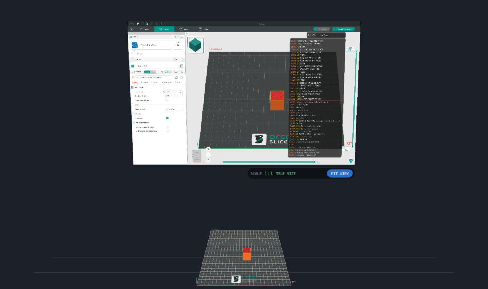
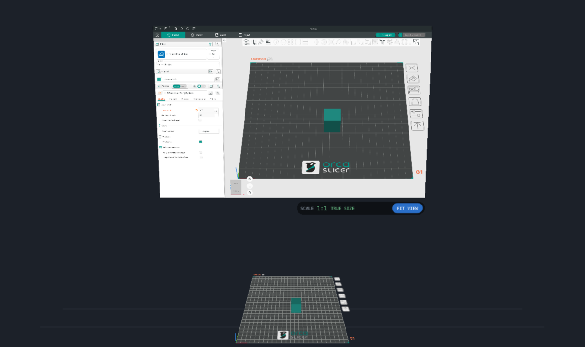

# OrcaSlicer XR

The full [OrcaSlicer](https://github.com/OrcaSlicer/OrcaSlicer) in a headset, on **Meta Quest 3** (and other Android
OpenXR headsets): a variation of [OrcaSlicer for Android](https://github.com/LucasCoraca/orcaslicer-android) with
OrcaSlicer's window in front of you, and the build plate with your objects standing in the room on a table, at their real
size.

> **Unofficial community port, preview quality.** Not affiliated with or endorsed by the OrcaSlicer team.



## What it is

It is OrcaSlicer itself (the same engine, profiles, settings and G-code as the desktop version, through OrcaSlicer for
Android), with two changes in where things are:

- **The window** is OrcaSlicer's own interface, the desktop layout, on a 1.2 m panel about a metre in front of you:
  the top bar, the Prepare / Preview tabs, the printer, filament and process settings, the object list, every dialog and
  menu. Its 3D view is still there too, with its tool bars, the gizmo panels, the layer sliders and the legend.
- **The plate in the room**: the same scene (the plate, your objects, the gizmos, the sliced toolpaths in Preview)
  stands on a table in front of you, below the window, drawn for each eye by OrcaSlicer's own 3D view. It starts at its
  real size, 1 mm = 1 mm, so you see the print as it will come off the printer.

The controllers:

| Controller | On the window | In the room (the plate and what is on it) |
|---|---|---|
| Pointing | A mouse: hover | Hover: what the ray points at is highlighted, as under the mouse |
| Trigger | Left button: click, drag, double click | Left button in the 3D view: select objects (on the plate's icons too), drag them across the plate, use the move / rotate / scale / cut / paint gizmos on them |
| B / Y | Right click (context menus) | Right click: the object's context menu |
| Thumbstick | The mouse wheel (scroll lists, change values) | Up / down scales the plate, left / right turns it |
| Grip | Move the window | Pick the plate up and carry it; both grips: scale and turn it between your hands |
| A / X | Put the window and the plate back in front of you | |
| Scale badge (under the window) | **FIT VIEW**: the plate about half a metre across · **TRUE SIZE**: back to 1:1 · **PASSTHROUGH**: your room on / off | |

When a text field has the focus (a setting, a search, a name) a keyboard appears on the desk in front of you: point and
pull the trigger on its keys (**Done** closes it).

The room is Orca's 3D view seen from where the controller is: the ray gets a camera of its own looking down it, with
the mouse at its centre, so Orca's own picking, selection, gizmos and drags work in the room unchanged
(`GLCanvas3D::xr_pointer` in the Android port). The scene is drawn for each eye by `GLCanvas3D::xr_render_eye`, in the GL
context of the canvas shown (the 3D view or the preview).

## Status (0.1.0)

Tested on the Android emulator, in the headset-free preview (below): Orca's whole interface on the window (tabs,
settings, the object list, menus, dialogs, the Home page and the setup wizard), typing into settings with the keyboard,
the plate in the room drawn by Orca, adding an object from the plate's right-click menu in the room, selecting and
dragging it across the plate with the ray, slicing, and the sliced toolpaths in the room.

Not yet run on a Quest: the OpenXR path (the session, the compositor layers, passthrough, the controllers) is MobileCAD
XR's, built against Orca's GL context sharing, and untested on hardware so far. Reports are welcome.

Known limitations:

- A right-click menu opened in the room appears where the pointer last was on the window.
- Hand tracking is off (as in MobileCAD XR): use the controllers.
- File dialogs (import, export, save) are Android's own picker, which opens as a flat window outside the immersive view.

## Install on a Quest 3

Enable developer mode (Meta Horizon app → Devices → Developer mode), connect the headset by USB, then
`adb install OrcaSlicer-XR-quest.apk` (or drag the APK into Meta Quest Developer Hub). It appears under
*Library → Unknown sources*. The first start unpacks the profiles and takes a few seconds.

## Without a headset

On a phone, tablet or the Android emulator (`OrcaSlicer-XR-emulator-x86_64.apk`) there is no OpenXR runtime: the app
shows a preview of the XR scene, OrcaSlicer's window and the plate in front of you. One finger is the controller with its
trigger pressed (on the window it is the mouse, on the plate the 3D view's mouse); two fingers look around.



## How it is built

```
 orcaslicer-android/   OrcaSlicer for Android (submodule): the engine, wxWidgets on Qt, the Android app, its patches
 android/              the headset app: XrActivity (Orca's Qt interface onto a virtual display), orca_xr.cpp (Orca's
                       side: frames on Qt's GUI thread, the scene per eye, the mouse, the keyboard), xr_glue.cpp (OpenXR,
                       the window texture, the preview)
 core/                 the XR core (from MobileCAD XR): OpenXR session, interaction, renderer, controller models
 third_party/openxr/   Khronos OpenXR loader for Android and headers (Apache-2.0)
 assets/models/        Quest 3 Touch Plus controller models (WebXR Input Profiles, MIT)
```

OrcaSlicer's Qt interface runs on a virtual display (`XrActivity.setContentView` puts Qt's root layout on a
`Presentation`); its image is a `SurfaceTexture` the headset shows as a compositor layer. The XR loop runs on Qt's GUI
thread in the GL context of Orca's 3D view, so Orca draws its scene straight into the eyes' images.

Build OrcaSlicer for Android first (its README: dependencies, Qt for Android, NDK), then:

```sh
git submodule update --init
ORCA_ANDROID=/path/to/built/orcaslicer-android ./build.sh arm64-v8a   # -> dist/OrcaSlicer-XR-quest.apk
ORCA_ANDROID=/path/to/built/orcaslicer-android ./build.sh x86_64      # -> dist/OrcaSlicer-XR-emulator-x86_64.apk
```

Development on the emulator (x86_64): `ORCA_ANDROID=... ./devrun.sh` rebuilds, installs and starts the app and shows its
log; `./devtools.sh click X Y` clicks the window at a pixel of it, `./devtools.sh panel out.png` saves the window's image
(its virtual display is private, so `screencap` cannot see it), `./devtools.sh shot out.png` the screen. In the preview a
gamepad (or `adb shell input keyevent`) stands in for the controller's buttons: `BUTTON_B` / `BUTTON_Y` right click,
`BUTTON_A` menu, the D-pad the thumbstick, `BUTTON_L1` the grip.

## License

[GNU AGPL-3.0](LICENSE), as OrcaSlicer. The OpenXR loader is Apache-2.0 (`third_party/openxr/LICENSE`), the controller
models MIT (`assets/models/LICENSE-webxr-input-profiles.md`), cgltf MIT and stb_image public domain (`core/third_party`).
